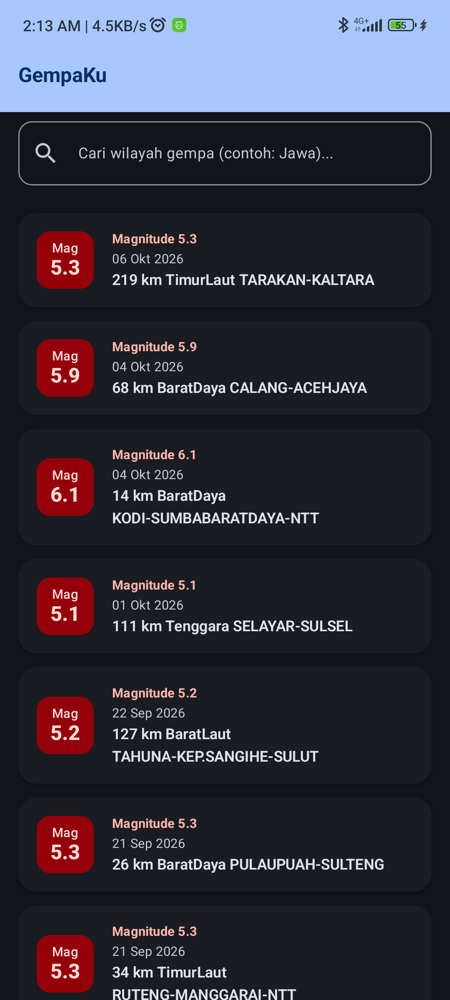
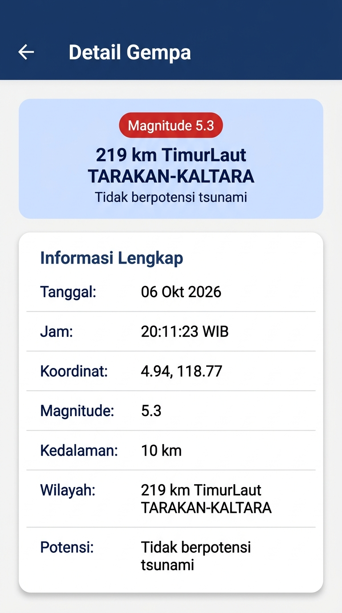

# GempaKu

Aplikasi Android untuk menampilkan informasi gempa bumi terkini di Indonesia secara dinamis dari **BMKG REST API**. Dibangun menggunakan **Kotlin**, **Jetpack Compose**, **Material Design 3**, dan arsitektur **MVVM**.

Proyek ini dibuat untuk memenuhi tugas **Responsi / Ujian Praktikum Pemrograman Mobile**.

---

## Screenshots Aplikasi

Berikut adalah tangkapan layar 2 layar aplikasi (*Home Screen* dan *Detail Screen*):

| Home Screen (Layar Utama) | Detail Screen (Layar Rincian) |
| :---: | :---: |
|  |  |
| *TopAppBar, SearchBar, dan LazyColumn Data BMKG* | *Informasi Lengkap 7 Parameter & Back Button* |

---

## Fitur Aplikasi

1. **Daftar Gempa Terkini**: Menampilkan 15 gempa bumi terkini (M ≥ 5.0) dari BMKG menggunakan `LazyColumn` (tanpa `RecyclerView`, `Grid`, atau `LazyRow`).
2. **Pencarian Lokal Berdasarkan Wilayah**: Filter instan berdasarkan kata kunci wilayah (contoh: *"Jawa"*, *"Maluku"*, *"Aceh"*) secara *case-insensitive* pada data yang sudah diunduh di memori tanpa memanggil ulang API BMKG.
3. **Penanganan State Reaktif (`UiState`)**:
   - **Loading State**: Menampilkan `CircularProgressIndicator` dan teks `"Loading earthquake data..."`.
   - **Success State**: Menampilkan daftar gempa atau pesan kosong jika wilayah tidak ditemukan.
   - **Error State**: Menampilkan pesan `"Failed to load earthquake data."` disertai tombol **Retry** untuk memuat ulang jika koneksi terputus.
4. **Navigasi Layar (Navigation Compose)**:
   - Terdiri dari maksimal 2 layar (`Home` dan `Detail`).
   - Setiap kartu gempa dapat diklik untuk berpindah ke layar Detail.
   - Layar Detail dilengkapi tombol kembali (*Back button*) untuk kembali ke Home.
5. **Detail Informasi Gempa Lengkap**:
   Menampilkan 7 atribut data sesuai ketentuan:
   - Tanggal
   - Jam
   - Koordinat (*Coordinates*)
   - Magnitude
   - Kedalaman
   - Wilayah
   - Potensi (*Potensi Tsunami*)
6. **Material Design 3 Theme**:
   - Palet warna kustom (*Navy Blue Primary* `#1B3B6F` & *Alert Red Accent* `#BA1A1A`).
   - Mendukung penuh **Light Mode** dan **Dark Mode** secara dinamis.
   - Override tipografi Material 3 di `Type.kt`.

---

## Arsitektur Aplikasi (MVVM)

Aplikasi mengikuti kaidah arsitektur **MVVM (Model - View - ViewModel)** murni:

```
[ Composable / UI ]
  HomeScreen.kt & DetailScreen.kt
       │          ▲
       │          │ (Mengamati StateFlow: uiState, searchQuery)
       ▼          │
[ ViewModel ]
  EarthquakeViewModel.kt
       │          ▲
       │          │ (Memanggil suspend function dalam viewModelScope)
       ▼          │
[ Repository ]
  EarthquakeRepository.kt
       │          ▲
       │          │ (Single Source of Truth)
       ▼          │
[ Remote Data Source ]
  RetrofitInstance.kt & BmkgApiService.kt
       │          ▲
       │          │ (HTTP GET Request / JSON Response)
       ▼          │
[ BMKG REST API ]
  https://data.bmkg.go.id/DataMKG/TEWS/gempaterkini.json
```

- **Separasi Tugas**: Composable **tidak pernah** memanggil API secara langsung. Composable hanya bertugas me-render UI berdasarkan `StateFlow` dan meneruskan event pengguna ke ViewModel.
- **Repository**: Berperan sebagai jembatan yang mengabstraksi sumber data ke ViewModel.

---

## Spesifikasi REST API BMKG

- **Penyedia**: Badan Meteorologi, Klimatologi, dan Geofisika (BMKG)
- **Autentikasi**: Publik (Tanpa API Key)
- **Base URL**: `https://data.bmkg.go.id/`
- **Endpoint**: `DataMKG/TEWS/gempaterkini.json`
- **Full URL**: `https://data.bmkg.go.id/DataMKG/TEWS/gempaterkini.json`
- **Struktur JSON Response**:
  ```
  Infogempa
      └── gempa[] (Array of Earthquake objects)
  ```
- **Pemetaan Model**:
  Model data di `Earthquake.kt` menggunakan anotasi `@SerializedName` dari Google Gson untuk memetakan key JSON (`Tanggal`, `Jam`, `Coordinates`, `Magnitude`, `Kedalaman`, `Wilayah`, `Potensi`).

---

## Detail Teknis & Dependensi

Proyek menggunakan dependensi minimal sesuai batasan instruksi tugas (tanpa Room, tanpa Hilt/Koin, tanpa Coil/Glide, tanpa library gambar pihak ketiga):

| Library | Versi | Kegunaan |
|---|---|---|
| `androidx.compose.material3:material3` | BOM-managed | Komponen Material Design 3 UI |
| `androidx.navigation:navigation-compose` | 2.9.3 | Navigasi deklaratif antar Composable |
| `androidx.lifecycle:lifecycle-viewmodel-compose` | 2.8.7 | Integrasi ViewModel lifecycle di Compose |
| `com.squareup.retrofit2:retrofit` | 2.11.0 | HTTP Client untuk konsumsi REST API |
| `com.squareup.retrofit2:converter-gson` | 2.11.0 | Deserialisasi JSON BMKG ke objek Kotlin |
| `com.google.code.gson:gson` | 2.11.0 | Google JSON serialization/deserialization |
| `androidx.compose.material:material-icons-extended` | BOM-managed | Icon Material 3 (Search, Clear, Back, Refresh) |

- **Izin Akses Jaringan**: Dideklarasikan di `AndroidManifest.xml`:
  ```xml
  <uses-permission android:name="android.permission.INTERNET" />
  ```

---

## File APK Debug

File APK siap pasang (*debug build*) tersedia di repositori:
- **Lokasi file**: [apk/GempaKu-debug.apk](apk/GempaKu-debug.apk)

---

## Video Penjelasan Kode

- **Link Video**: [https://youtu.be/knR9wc4nsz0](https://youtu.be/knR9wc4nsz0)  
  *(Video penjelasan kode berfokus membahas arsitektur MVVM, Retrofit, StateFlow, dan Composable)*
